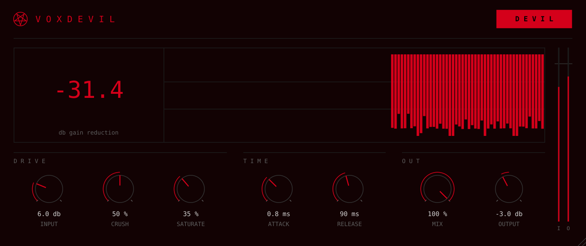

# VOX BUNDLE

Десять вокальных плагинов в формате **Audio Unit** для macOS (universal: Apple Silicon + Intel).
Чёрный фон, один красный цвет, тонкие линии. Окно масштабируется за правый нижний угол.



## DEVIL

В шапке каждого плагина есть кнопка **DEVIL**. При включении плагин уходит в перегруз:
на выходе включается общий асимметричный овердрайв (плавное включение, без щелчка), а сам плагин доводит свою обработку до крайности.
Фон интерфейса при этом становится тёмно-бордовым. Кнопка автоматизируется, как любой параметр.

| Плагин | Что делает | Что делает DEVIL |
|---|---|---|
| **VoxComp** | компрессор с мягким коленом, сплит-де-эссер, пик-лимитер | стена 20:1, атака 0.1 мс, порог −10 дБ, +8 дБ makeup |
| **VoxEQ** | low cut 12/24, body, mid, presence, air; точки на кривой перетаскиваются | все подъёмы и вырезы удваиваются |
| **VoxHeat** | сатурация tape / tube / soft / hard, 4× oversampling, авто-гейн | +18 дБ драйва и вэйвфолдинг |
| **VoxSpace** | FDN-ревёрб (8 линий), темповый дилей, пинг-понг, даккинг | дилей самовозбуждается, хвост ревёрба ×3, wet перегружен |
| **VoxSynth** | вокодер на 20 полос, 8 голосов, drone-аккорд или MIDI | суб-октава, ×2.5 шума, форманта −5 полутонов |
| **VoxDouble** | 2/4 дабла с микро-расстройкой и плавающим таймингом | 4 голоса, расстройка ×4, максимальный дрейф, грязь |
| **VoxTune** | автотюн: тональность, лад, retune, humanize | retune 0 (робот) + демонический слой на октаву ниже |
| **VoxPitch** | питч-шифтер ±24 полутона, fine, зерно с синхронизацией по высоте тона | демонический слой на −18 полутонов |
| **VoxDevil** | компрессор с обратной связью: одна ручка crush, сатурация в петле, параллельный микс | crush выше 100 %, бесконечное сжатие, пампинг |
| **VoxAdlib** | эдлибы: phone / radio / megaphone, октавы ±12, ширина Haas, темповые «броски» | мегафон, октава вниз, бесконечные повторы |

AU-коды: производитель `Vxbd`, плагины `Vcmp Veqz Vhet Vspc Vsyn Vdbl Vtun Vpit Vdvl Vadl`
(все `aufx`, кроме VoxSynth: он `aumf`, принимает MIDI).

## Установка

1. Скачайте `VoxBundle-1.0.0.dmg` из **Releases** (или из **Actions** → артефакт `VoxBundle-installer`).
2. Откройте DMG и дважды кликните **Install Vox Bundle.pkg**. Установщик положит плагины в `/Library/Audio/Plug-Ins/Components`.
   Установщик не подписан сертификатом Apple Developer, поэтому macOS один раз предупредит об этом:
   *Системные настройки → Конфиденциальность и безопасность → «Всё равно открыть»*, затем запустите установщик снова.
3. **FL Studio 26**: *Options → Manage plugins → Find plugins*. Плагины появятся у производителя «Vox Bundle».

## Сборка установщика на своём Mac

Нужны Xcode Command Line Tools и CMake:

```bash
xcode-select --install
```

```bash
brew install cmake
```

Затем из папки с исходниками:

```bash
bash scripts/build-mac.sh --install
```

Скрипт соберёт все 10 плагинов (universal), сделает `dist/VoxBundle-1.0.0.pkg` и `.dmg` и сразу запустит установку (без `--install` только соберёт установщик).

**VoxSynth** по умолчанию в режиме *drone*: держит аккорд сам, MIDI не нужен.
Для игры нотами переключите *notes → MIDI*, в настройках обёртки плагина задайте MIDI input port,
а на канале **MIDI Out** выставьте тот же порт.

**VoxTune / VoxPitch** сообщают хосту свою задержку (~12–15 мс), FL Studio компенсирует её автоматически.

## Ручная сборка

```bash
cmake -S . -B build -DCMAKE_BUILD_TYPE=Release
```

```bash
cmake --build build --config Release -j 8
```

Компоненты появятся в `build/<Plugin>_artefacts/Release/AU/`. Чтобы собрать ещё и VST3, добавьте `-DVOX_FORMATS="AU;VST3"`.

### Тест без DAW (Linux / CI)

```bash
cmake -S . -B build -G Ninja -DCMAKE_BUILD_TYPE=Release -DVOX_BUILD_SELFTEST=ON
```

```bash
cmake --build build --target VoxSelfTest && xvfb-run -a ./build/VoxSelfTest_artefacts/Release/VoxSelfTest --shots docs/screenshots
```

Что проверяется: синтетический голос через каждый плагин (дефолты, DEVIL, моно/стерео, 40 случайных наборов параметров),
сохранение и восстановление состояния, реальный RT60 ревёрба против ручки Decay,
точность VoxTune и VoxPitch по высоте тона (погрешность ≤ 15 центов, на практике 0–4), скриншоты GUI.

CI (`.github/workflows/build-au.yml`): на macOS universal-сборка, подпись, установка собранного `.pkg`, `auval` для всех 10 плагинов, артефакт с `.dmg` и `.pkg`; на Linux тот же self-test.

## Структура

```
shared/      DSP, pitch (YIN + гранулярный шифтер), параметры, базовый процессор с DEVIL, look&feel, редактор
plugins/     по папке на плагин: Processor + Editor + Entry
tests/       self-test
packaging/   сборка установщика .pkg / .dmg
```

JUCE 8 распространяется под AGPLv3 или коммерческой лицензией. Для личного использования ограничений нет.
